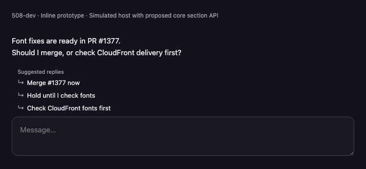
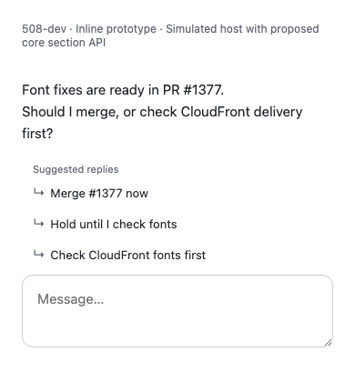
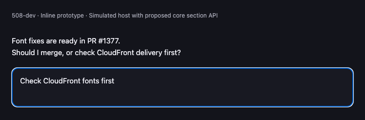

# Replies for Paseo

An experimental 508-dev plugin that shows a small **Suggested replies** title and up to three choices above Paseo's normal message input. There is no pill, popup, or dismiss button. Selecting a reply fills the input and focuses it for editing; it never sends automatically or replaces an existing draft.

Suggestions disappear after selection, when you type, or when the agent starts another turn. Clearing your draft does not bring old suggestions back.

**This branch needs the accompanying, unreleased Paseo composer section API.** The published 0.16.0-beta.2 client does not include it. Build Paseo with [core PR #9520](https://github.com/getpaseo/paseo/pull/9520) before installing this branch. The plugin fails with an update message on clients without that API; it does not fall back to the old pill.

```sh
paseo plugin install git:508-dev/paseo-replies --ref inline-suggestions
```

For the released pill-based prototype, use the `v0.2.0` Git reference. Plugins must already be enabled under Settings → Plugins. Plugins are trusted, unsandboxed code on the daemon host and in the app.

## Screenshots

Browser-fixture previews of the actual inline section component with sample data and a simulated host using the proposed core API. The message box represents Paseo's normal composer. These are not live Paseo or native app captures; see [verification limits](QA.md).

**Desktop, dark theme**



**Compact layout, light theme**



**After choosing a suggestion**



## Generation settings

Open this plugin's settings under Settings → Plugins:

- **Generate after each turn:** turn future generation on or off. Suggestions already displayed remain until the next turn or plugin reload.
- **Claude model:** defaults to `haiku`. Set a Claude CLI model alias or full model ID, independently of the conversation's provider and model.
- **Claude executable:** defaults to `claude`; alternatively set an executable name or absolute path on the daemon host. Log in to that CLI first. A wrapper must implement the Claude CLI arguments. Arbitrary provider APIs are not supported in this prototype.

Settings apply to future requests and are shared by clients of this host. Existing cached replies are keyed by model, executable, and input; duplicate in-flight requests are shared. At most four different requests run concurrently. Failures show a retry action in the pill.

The last assistant message (up to 4,000 characters) and preceding user message (up to 500 characters) go through the configured Claude CLI to its model provider. No tools, MCP servers, project settings, hooks, or saved sessions are enabled for that call. Opening the app does not generate replies for old turns. Each request has a 30-second timeout.

## Prototype limits

Inline placement requires the unreleased core section hook. Tab-to-accept and arrow-key choice are not implemented. The plugin owns generation and the hide-on-selection/typing/new-turn behavior; the core hook only mounts content above the input.

Generation follows agent status transitions observed by an open client. A disconnected client can miss a completed turn. Multiple clients share identical in-flight generation but do not share suggestion UI state. Disabling generation does not cancel a request already running.

## Development

```sh
npm ci --ignore-scripts
npm run typecheck
npm run lint
npm exec -- vitest run test/suggestions.test.ts test/insert-reply.test.ts test/generation.test.ts test/replies.test.ts --bail=1
npm run format
paseo plugin reload replies-508
```

Paseo supplies runtime dependencies; installing from Git requires no preparation commands.

Core API proposal: [composer suggestions and Tab-to-accept](https://github.com/getpaseo/paseo/discussions/9516).

## Attribution

Derived from [cleiter/paseo-replies](https://github.com/cleiter/paseo-replies), commit `aab1c77`, under Apache-2.0. Original history and LICENSE are retained. 508-dev changed reply acceptance to editable drafts and added model configuration, visible errors, request deduplication, and regression tests. This fork is an independent prototype.
